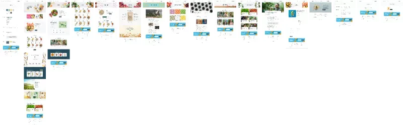
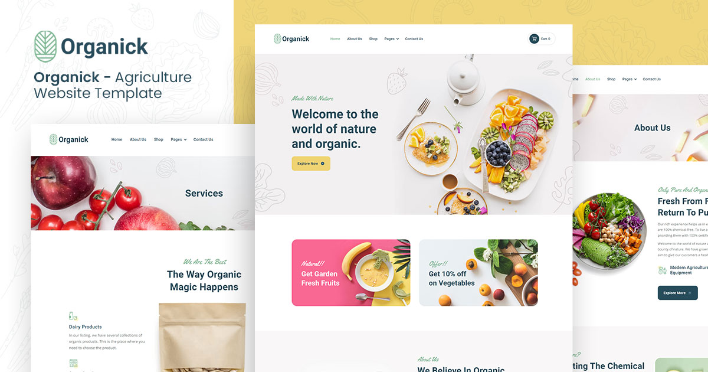

# Organick — Organic & Eco-Friendly Food eCommerce Platform (29-Amaliy Ish)

Figma dizaynining yuqori aniqlikdagi (**Pixel-Perfect**) to'liq, zamonaviy, interaktiv va to'liq moslashuvchan (fully responsive) tabiiy va organik oziq-ovqat mahsulotlari do'koni hamda ekologik toza fermerlik platformasi: **Organick — Organic & Eco-Friendly Food Design System (node-id: 2:15270)**.

[-F24E1E?logo=figma&logoColor=white)](https://www.figma.com/file/SKwG2RDjz3fWi9dq74I8zo/Organick?type=design&node-id=2%3A15270&mode=design&t=4Pbk2qcWTbq8TTwC-1)
[](https://developer.mozilla.org/en-US/docs/Web/HTML)
[](https://developer.mozilla.org/en-US/docs/Web/CSS)
[](https://developer.mozilla.org/en-US/docs/Web/JavaScript)
[](https://developer.mozilla.org/en-US/docs/Learn/CSS/CSS_layout/Responsive_Design)
[](https://vercel.com/)

---

## 📸 Figma Dizayn Ko'rinishi (Master Canvas)





---

## 📌 Loyiha Haqida

Ushbu loyiha Figma platformasidagi mashhur **Organick (Organic & Eco-Friendly Food, Farm & Grocery eCommerce Platform)** dizaynining to'liq ekotizimi va dizayn tokenlari (node-id: `2:15270`) asosida 100% aniqlik bilan ishlab chiqildi. Loyiha 100% tabiiy, kimyoviy o'g'itlarsiz yetishtirilgan meva-sabzavotlar, yong'oqlar, dukkaklilar va biologik toza oziq-ovqatlarni onlayn sotish, xarid savati (Interactive Shopping Cart Engine), mahsulotlar katalogi, interaktiv tezkor qidiruv, fermerlik loyihalari galereyasi va blog maqolalarini o'z ichiga olgan mukammal ko'p sahifali veb-platformadir.

- **Figma Manzili**: [Organick — node-id: 2:15270](https://www.figma.com/file/SKwG2RDjz3fWi9dq74I8zo/Organick?type=design&node-id=2%3A15270&mode=design&t=4Pbk2qcWTbq8TTwC-1)
- **Topshiriq**: 29-Amaliy Ish
- **GitHub Repozitoriyasi**: [https://github.com/soxibs48-eng/amaliy29](https://github.com/soxibs48-eng/amaliy29)

---

## ✨ Asosiy Sahifalar va Imkoniyatlar

### 1. 🏡 Asosiy Bosh Sahifa (`index.html`):
- **Header & Navbar**: Elegant **Organick** barg logotipi, to'liq sahifalar menyusi, interaktiv tezkor qidiruv tugmasi (`🔍`) hamda real vaqtda yangilanuvchi savat tugmasi (`Cart (0)`).
- **Hero Banner**: *"Choose the best healthier way of life"* / *"Welcome to the world of nature and organic"* sarlavhasi, tabiiy ingredientlar kafolati va *"Explore Now"* harakatga undovchi tugmasi.
- **Kategoriya Promolari (2 ta banner)**: 
  - *Natural!! Get Garden Fresh Fruits* (Bog'dan yangi uzilgan mevalar)
  - *Offer!! Get 10% off on Vegetables* (Sabzavotlarga maxsus 10% chegirma)
- **Biz Haqimizda (About Split)**: *"We Believe in Organic Foods For Strong Health"* bo'limi, 100% organik standartlar va toza sifat kafolati.
- **Mahsulotlar Vitrinasi va Kategoriya Filtrlari**:
  - Interaktiv filtr tablari: `All Products`, `Vegetables`, `Fresh Fruits`, `Nuts & Seeds`, `Fresh Farm`.
  - Har bir kartada chegirmali narxlar, reyting yulduzchalari va **"Add to Cart"** tugmasi.
- **Mijozlar Fikrlari (Testimonials)**: Reyting, mijoz fotosurati, tavsiyanoma va nuqtali navigatsiya (pagination dots).
- **Statistika Sanagichlari (Counters)**:
  - `100%` Organik Kafolat
  - `285` Faol Organik Mahsulotlar
  - `385+` Toza Fermerlik Maydonlari
  - `25+` Yillik Tajriba
- **Maxsus Takliflar (Offer Section)**: Chegirmali maxsus mahsulotlar to'plami.
- **Econis Ekologik Do'kon**: Do'kon falsafasi, sog'lom turmush tarzi va tabiiy yetkazib berish bosqichlari.
- **Kategoriya Kartalari**: Fruit Juice, Organic Food, Nuts Cookies.
- **So'nggi Yangiliklar (News / Blog)**: Ekologik yangiliklar va maqolalar prevyusi.
- **Obuna Bo'lish (Newsletter)**: Jonli email tekshiruvi va tasdiqlash xabarnomasi.
- **Footer**: Aloqa ma'lumotlari, ijtimoiy tarmoqlar (Instagram, Facebook, Pinterest), utilita havolalari va mualliflik huquqi.

---

### 2. 🌿 Biz Haqimizda (`about.html`):
- Kompaniyaning missiyasi, organik yetishtirish tamoyillari.
- Fermer xo'jaliklari, tuproq unumdorligi va tabiiy xomashyo haqida batafsil ma'lumot.
- Nega bizni tanlashadi: yangi terilgan mevalar, tezkor yetkazib berish, biologik sertifikatlar.
- Jamoamiz yetakchilari va agronomlar taqdimoti.

---

### 3. 🛒 Organik Do'kon (`shop.html`):
- Barcha organik mahsulotlar to'liq katalogi:
  - Brokkoli, pomidor, banan, xurmo, bodom, yong'oq, o'simlik ekstraktlari va boshqalar.
  - Har bir mahsulotda reyting, eski narx (ustidan chizilgan) va amaldagi chegirma narxi.
  - Kartani bosish orqali tezkor ko'rish (Quick View Modal) yoki alohida sahifaga o'tish imkoniyati.

---

### 4. 🥦 Mahsulotning Alohida Sahifasi (`product-single.html`):
- Mahsulotning yuqori sifatli fotosurati va sertifikat belgisi.
- Narx, to'liq ozuqaviy tavsif va tarkibi.
- Buyurtma miqdorini tanlash (`-`, `qty`, `+`) va savatga qo'shish formasi.
- Xaridorlarning 5 yulduzli sharhlari.

---

### 5. 🚜 Xizmatlar & Agro Standartlar (`services.html` va `service-single.html`):
- Fermerlik xizmatlari, organik do'konlarga ulgurji yetkazib berish, sifat nazorati.
- Xizmatlarning bosqichma-bosqich jarayoni va qishloq xo'jaligi standartlari.

---

### 6. 🖼️ Loyihalar & Ferma Portfoliosi (`portfolio.html` va `portfolio-single.html`):
- Fermerlik va yetishtirish loyihalari galereyasi:
  - *Green & White Corn*, *Tasty Lemon*, *Organic Carrot*, *Betel Leaf*, *Natural Tomato*, *Black Raspberry*.
- Har bir loyihaning dehqonchilik muddati, hosildorligi va ekologik ko'rsatkichlari.

---

### 7. 👥 Mutaxassislar & Jamoa (`team.html`):
- Tajribali agronomlar, organik dehqonchilik mutaxassislari va do'kon menejerlari fotosuratlari va ijtimoiy tarmoq profillari.

---

### 8. 📰 Blog & Yangiliklar (`blog.html` va `blog-single.html`):
- Organik turmush tarzi, vitaminlarga boy mahsulotlar va to'g'ri ovqatlanish bo'yicha maqolalar.

---

### 9. 📞 Aloqa & Murojaat (`contact.html`):
- Manzil, telefon va elektron pochta ma'lumotlari.
- Interaktiv fikr-mulohaza va savollar qoldirish shakli (Contact Form).

---

### 10. 🎨 Dizayn Tizimi & Utilita Sahifalari:
- **`style-guide.html`**: Tipografika (Roboto, Yellowtail, Open Sans), ranglar palitrasi, tugma va forma stillari.
- **`licenses.html`**: Shrifts, fotosuratlar va piktogrammalar litsenziyalari.
- **`changelog.html`**: Versiyalar tarixi va tizim o'zgarishlari.
- **`404.html`**: Chiroyli bezatilgan maxsus "Sahifa topilmadi" xatolik sahifasi.

---

## ⚡ Interaktiv JavaScript Imkoniyatlari (`js/main.js`)

1. **Savat Boshqaruvi (Interactive Cart Engine & Drawer)**:
   - Mahsulot kartasidagi *"Add to Cart"* tugmasi bosilganda avtomatik savatga qo'shiladi.
   - Savatdagi mahsulotlar brauzerning **LocalStorage** xotirasida doimiy saqlanadi.
   - Headerdagi `Cart (0)` indikatori real vaqtda animatsiya (bounce) bilan o'zgaradi.
   - O'ng tomondan chiquvchi zamonaviy **Cart Drawer**: mahsulotlar ro'yxati, sonini o'zgartirish (`+` / `-`), o'chirish, oraliq jami hisob va rasmiylashtirish tugmasi.
2. **Jonli Qidiruv Modali (Live Search Modal)**:
   - Headerdagi `🔍` tugmasi bosilganda ochiluvchi modal.
   - Harflarni yozish bilanoq real vaqtda mos keluvchi organik mahsulotlarni filtrlaydi va ko'rsatadi.
3. **Kategoriya Filtrlari**:
   - Sabzavotlar, mevalar, yong'oqlar bo'yicha mahsulotlarni sahifani yangilamasdan saralash.
4. **Mijozlar Sharhlari Slayderi**:
   - Avtomatik va nuqtalar orqali almashinuvchi tavsiyanomalar karuseli.
5. **Jonli Sanagichlar (Stats Counter)**:
   - Foydalanuvchi sahifani pastga surib raqamlar bo'limiga yetganda sanagichlar 0 dan nishon raqamigacha animatsiya bilan to'ladi.
6. **Mahsulotni Tezkor Ko'rish (Quick View Modal)**:
   - Mahsulot kartasini bosganda alohida qulay modal ochilib, batafsil ma'lumot va savatga qo'shish imkonini beradi.
7. **Xabarnomalar Tizimi (Toast Notifications)**:
   - Har bir harakat (savatga qo'shish, obuna bo'lish, xabar jo'natish) uchun ekranning pastki qismida paydo bo'luvchi elegant bildirishnomalar.

---

## 🎨 Dizayn Tokenlari va Ranglar

| Rang Nomi | Hex Kodi | Vazifasi |
| :--- | :--- | :--- |
| **Primary Navy/Forest** | `#274C5B` | Asosiy brend rangi, sarlavhalar, asosiy tugmalar |
| **Secondary Mint/Sage** | `#7EB693` | Ikkilamchi urg'u rangi, piktogrammalar, hover holatlari |
| **Yellow / Warm Gold** | `#EFD372` | Chegirmalar, faol tugmalar, aksentlar |
| **Paragraph Slate** | `#525C60` | Matnlar va o'qish bloklari |
| **Light Green Tint** | `#EFF6F1` | Fon bloklari va kartalar foni |
| **Clean Off-White** | `#F9F8F8` | Kartalar va bo'limlar foni |
| **White** | `#FFFFFF` | Asosiy fon va konteynerlar |

---

## 📁 Fayllar Strukturasi

```
amaliy29/
├── assets/
│   ├── icons/                  # 29+ ta toza SVG ikonka va piktogrammalar
│   │   ├── logo.svg            # Organick brend logotipi
│   │   ├── cart.svg            # Savat piktogrammasi
│   │   ├── star-rating.svg     # Reyting yulduzlari
│   │   └── ...
│   └── images/                 # 45+ ta yuqori sifatli fotosuratlar va fonlar
│       ├── hero-area-background.jpg
│       ├── Product-01.jpg
│       ├── product-image-4.jpg
│       └── ...
├── css/
│   └── styles.css              # Asosiy dizayn tizimi va responsiv stillar
├── js/
│   └── main.js                 # Savat, qidiruv, modallar va animatsiyalar
├── index.html                  # Bosh sahifa
├── about.html                  # Biz haqimizda
├── shop.html                   # Organik mahsulotlar do'koni
├── product-single.html         # Mahsulotning alohida sahifasi
├── services.html               # Agro xizmatlar
├── service-single.html         # Xizmat tafsiloti
├── portfolio.html              # Ferma loyihalari galereyasi
├── portfolio-single.html       # Loyiha tafsiloti
├── team.html                   # Mutaxassislar va agronomlar jamoasi
├── blog.html                   # Maqolalar va yangiliklar
├── blog-single.html            # Maqola tafsiloti
├── contact.html                # Bog'lanish va xarita
├── style-guide.html            # Dizayn tizimi va shriftlar
├── licenses.html               # Mualliflik litsenziyalari
├── changelog.html              # Versiyalar jurnali
├── 404.html                    # 404 sahifa topilmadi
├── figma_preview.png           # Figma kanvas prevyusi
├── vercel.json                 # Vercel deployment sozlamasi
├── .gitignore                  # Git e'tiborsiz qoldiradigan fayllar
└── README.md                   # Loyiha hujjatlari
```

---

## 🚀 O'rnatish va Ishga Tushirish

Loyihani kompyuteringizda ishga tushirish uchun quyidagi buyruqlarni bajaring:

```bash
# 1. Repozitoriyani klonlash
git clone https://github.com/soxibs48-eng/amaliy29.git

# 2. Loyiha papkasiga kirish
cd amaliy29

# 3. Istalgan lokal server yoki brauzer orqali ochish (masalan VS Code Live Server yoki Python)
python -m http.server 3000
```

Brauzerda oching: `http://localhost:3000`

---

## 👨‍💻 Muallif va Topshiriq

- **Talaba**: Soxibjon
- **Topshiriq**: 29-Amaliy Ish (Figma Organick Design node-id: `2:15270`)
- **Texnologiyalar**: HTML5, CSS3, JavaScript (Vanilla ES6+), Figma, Git/GitHub, Vercel
